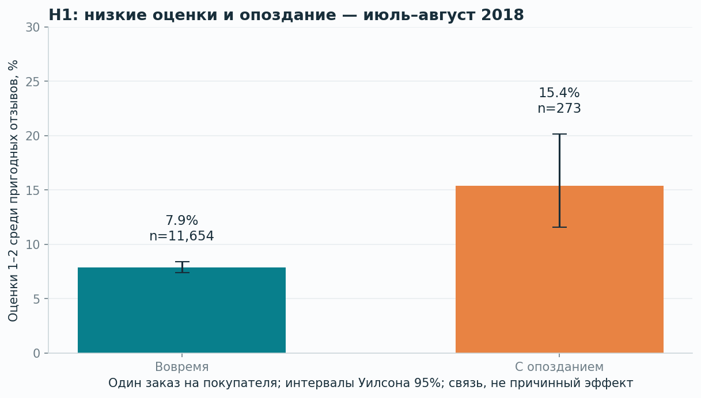

# Olist Delivery Experience Analysis

**Как опоздание доставки связано с низкими оценками — и какую продуктовую идею стоит проверить дальше?**

Продуктовое исследование 99 441 заказа маркетплейса Olist: SQL-витрина, проверка качества, EDA, статистические гипотезы, анализ отбора отзывов и модель риска опоздания. Продуктовый результат — приоритетная идея прозрачного статуса/уведомлений и план будущего A/B-теста.

**Стек:** Python, SQL / SQLite, pandas, NumPy, SciPy, matplotlib, scikit-learn, Jupyter.

Это учебный проект на открытых исторических данных Olist. Реальный эксперимент и внедрение не проводились; данные не принадлежат Авито.

## Результаты

| Результат | Значение | Область применимости |
| --- | --- | --- |
| Исходные заказы / использованные таблицы | 99 441 / 8 | Открытые данные Olist |
| Пригодные доставленные заказы | 96 123 | Январь 2017 — август 2018 |
| Низкие оценки при опоздании / вовремя | 15,38% / 7,88% | Июль–август 2018; первый пригодный заказ покупателя, первый отзыв за 0–30 дней после доставки |
| Разность долей низких оценок | +7,51 п.п.; 95% ДИ [3,68; 12,29] | Наблюдаемая связь; p с поправкой Холма ≈ 6,57 × 10⁻⁶ |
| Разность при включении всех первых отзывов | +37,38 п.п. | Включает ответы до доставки; другое определение наблюдаемого опыта |
| Средняя межштатная доставка длиннее | +4,13 дня; 95% ДИ [3,96; 4,30] | Проверочный период, один заказ покупателя и один продавец |
| Модель риска: ROC-AUC / Average Precision | 0,696 / 0,150 | Отдельный августовский тест; базовая доля опозданий 6,32% |
| Верхние 10% оценок риска | Precision 18,28%; Recall 28,97% | Ретроспективный сценарий ограниченной мощности |

**Ключевая находка:** в Olist опрос может приходить при наступлении обещанного срока, ещё до доставки. Среди опоздавших заказов такие ответы встречаются часто. Ограничение «только отзывы после доставки» существенно меняет размер связи. Поэтому несколько определений выборки показаны рядом, а отзывы до доставки не названы ошибками данных.



## Что сделано

1. Собрана SQL-витрина **одна строка — один заказ**. Товары и оплаты агрегируются до JOIN; итоговые суммы сверены с источниками.
2. Проверены ключи, связи таблиц, пропуски, порядок дат, несколько отзывов и продавцов. Опоздание определяется по календарным датам, без ложных опозданий внутри обещанного дня.
3. Построены 7 графиков: покрытие данных, динамика, распределение/Q–Q, ECDF маршрутов, доли низких оценок, направления, precision–recall.
4. Отделены discovery и validation. Проверены три основные гипотезы: z-тест долей, t-тест Уэлча, ANOVA Уэлча; p скорректированы Холмом. Шапиро и KS используются как дополнительные диагностики.
5. Проверена устойчивость H1: другие определения отзыва, bootstrap по продавцам, стандартизация по месяцу/штату с явным покрытием.
6. Построена логистическая регрессия с признаками на момент подтверждения оплаты, временным разделением и контролем доступности меток. Добавлена константная база.
7. Подготовлены рекомендации, приоритет продуктовой идеи и план эксперимента с единицей рандомизации, метриками, MDE и расчётом выборки.

## Где смотреть

| Файл | Содержание |
| --- | --- |
| [Выполненный ноутбук](notebooks/01_product_analysis.ipynb) | Анализ с кодом, таблицами, графиками и объяснениями |
| [Отчёт HTML](reports/summary.html) | Самодостаточный отчёт; откройте скачанный файл в браузере, интернет не нужен |
| [Отчёт Markdown](reports/summary.md) | Полное исследование для чтения на GitHub |
| [План гипотез](docs/hypotheses.md) | Вопросы, периоды, выборки, методы и ограничения до расчётов |
| [Памятка для собеседования](docs/interview_guide.md) | Логика методов, сложные вопросы и план изучения |
| [Описание для резюме](docs/resume_bullets.md) | Три проверяемых пункта, без заявления о внедрении |
| [SQL-витрина](sql/01_order_mart.sql) | Агрегации, ROW_NUMBER, соединения |
| [Основные проверки](src/statistics.py) | Доли, Уэлч, ANOVA, Холм, bootstrap, расчёт выборки |
| [Модель](src/model.py) | Момент прогноза, временные split, признаки и оценка |

## Быстрый запуск

Проверено на Python 3.12.14; нужны Python 3.11+ и SciPy 1.16+ для ANOVA Уэлча. Используйте отдельное окружение.

```bash
python -m venv .venv
```

Активация в Linux/macOS:

```bash
source .venv/bin/activate
```

Активация в Windows PowerShell:

```powershell
.venv\Scripts\Activate.ps1
```

Затем из корня проекта:

```bash
python -m pip install -r requirements.txt
python scripts/download_data.py
python run_analysis.py
python -m pytest -q
```

Скрипт загрузки получает публичный архив Olist с Kaggle. Если автоматическая загрузка недоступна, скачайте ZIP со [страницы источника](https://www.kaggle.com/datasets/olistbr/brazilian-ecommerce) и выполните:

```bash
python scripts/download_data.py --archive path/to/archive.zip
```

SQL выполняется в памяти процесса через стандартный sqlite3; отдельный сервер базы и большой файл SQLite не нужны. Итоги SQL-запроса 02_product_metrics.sql автоматически сверяются с независимым расчётом pandas и сохраняются в reports/tables/sql_monthly.csv.

Исходные CSV и промежуточные данные исключены из git. Архив проекта содержит выполненный ноутбук, графики и сводные результаты, поэтому читать исследование можно без скачивания исходных данных.

Заново собрать и выполнить ноутбук:

```bash
python scripts/build_notebook.py --execute
```

Если среда запрещает сетевые сокеты Jupyter, есть выполнение тех же ячеек через IPython без отдельного kernel-процесса:

```bash
python scripts/build_notebook.py --execute --in-process
```

В `requirements-tested.txt` записаны проверенные версии прямых зависимостей; это не полный lock транзитивных зависимостей. Точный использованный runtime, seed и контрольные суммы CSV находятся в reports/environment.json и data/source_manifest.json.

## Методология и ограничения

- Статистические тесты используют первый пригодный заказ каждого покупателя в соответствующей выборке. Основной описательный EDA включает повторные заказы.
- Отсутствующие отзывы не считаются положительными. H1 условна на наличие ответа. У разных определений немного различаются составы покупателей.
- Интервалы H1/H2 индивидуальные 95%; поправка Холма применяется к p-value, а не превращает интервалы в одновременные.
- Общие продавцы и сезон создают зависимость. Для H1 есть отдельная seller-cluster проверка; H2/H3 сохраняют эти ограничения.
- Между штатами разный состав продавцов/товаров. Сравнения не являются причинными оценками.
- У модели есть ограничение по будущей доставке: отменённые и недоставленные заказы исключены. Зрелость меток учтена, но приводит к отбору июльской validation.
- На августе логистическая регрессия лучше ранжирует риск, но хуже константной базы по Brier score. Для использования вероятностей нужна дополнительная калибровка.
- Нет полного трафика/корзины, обращений в поддержку и затрат. CR сайта, эффект уведомлений и прирост прибыли не измерены.
- Baseline 10% в примере расчёта A/B — **плановое допущение**, не статистика обращений из Olist.

## Проверки

12 тестов покрывают аналитические ошибки: умножение строк в JOIN, границу календарного дня, отзывы до доставки, длинные сроки, несколько продавцов, повторных покупателей, будущие метки, интервалы долей, поправку Холма и размер выборки. Общий пайплайн и все кодовые ячейки ноутбука выполнены на реальных данных.

## Источник и лицензии

[Brazilian E-Commerce Public Dataset by Olist](https://www.kaggle.com/datasets/olistbr/brazilian-ecommerce), CC BY-NC-SA 4.0. Благодарность Olist за опубликованные обезличенные данные. [Условия данных и атрибуция](DATA_LICENSE.md); исходный код — [MIT](LICENSE).
