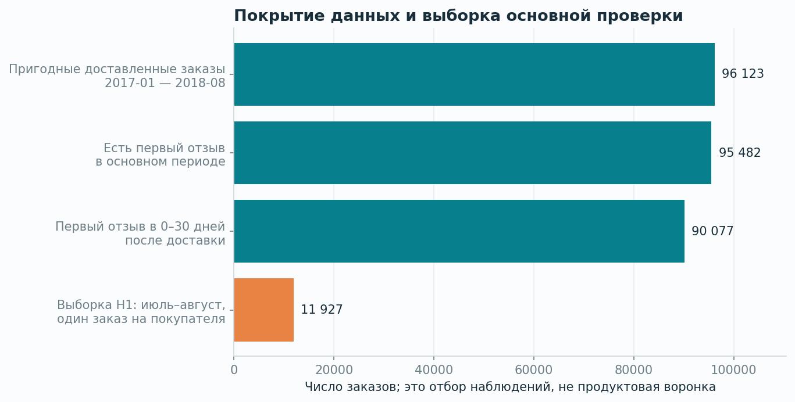
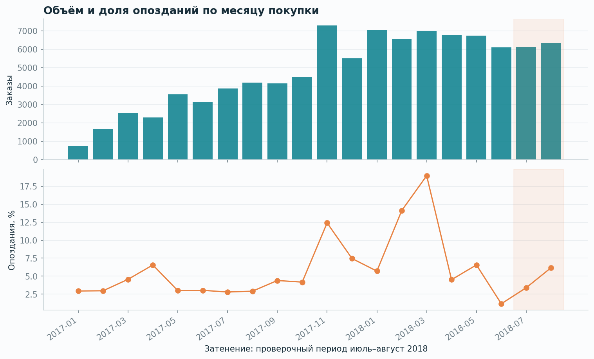
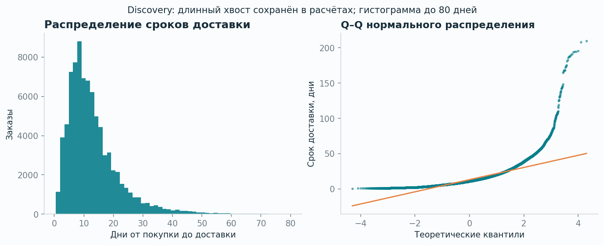
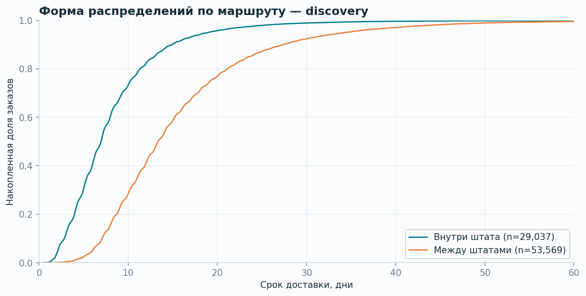
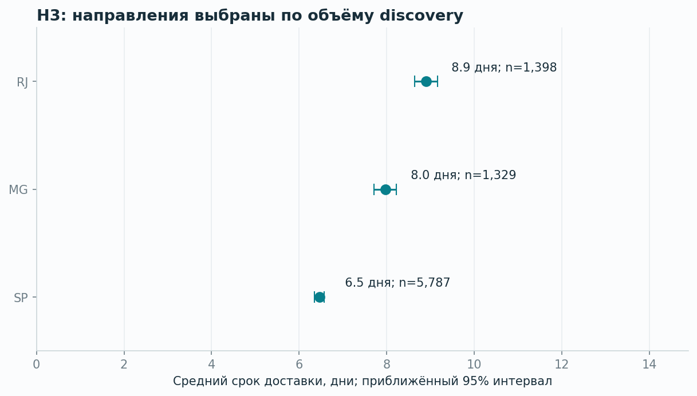
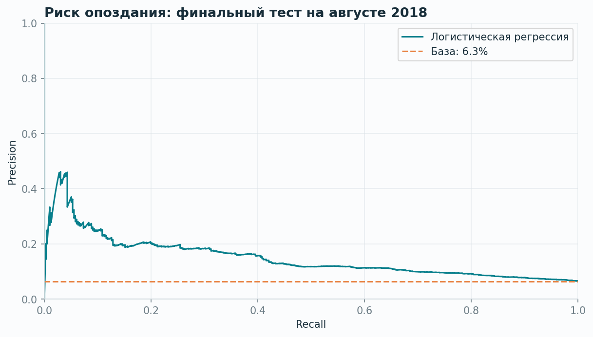

# Olist: опыт доставки и низкие оценки

Учебное продуктовое исследование открытых исторических данных Olist. Дата анализа: 28 октября 2026. Данные не принадлежат Авито; выводы не описывают пользователей Авито.

## Решение для продукта

Проверить, заслуживает ли сценарий ожидания опаздывающего заказа отдельного продуктового эксперимента. Рассматриваем прозрачный статус доставки и проактивное уведомление о риске задержки. Исследование оценивает связи и приоритет дальнейшей проверки; внедрения и измеренного прироста бизнес-метрик здесь нет.

## Результат в цифрах

- Исходные данные: **99 441 заказов**, 8 использованных таблиц; отдельная географическая таблица не нужна.
- Основная описательная выборка: **96 123** пригодных доставленных заказов, покупки с января 2017 по август 2018; опоздания — **6.79%**.
- H1, независимая проверочная часть: июль–август 2018, первый пригодный заказ каждого покупателя и первый отзыв в 0–30 дней после доставки. Низкие оценки: **15.38% при опоздании против 7.88% вовремя**, разность **+7.51 п.п.**, 95% интервал **[3.68; 12.29] п.п.**, p с поправкой Холма **6.57e-06**.
- H2: межштатная доставка в проверочном периоде в среднем длиннее на **4.13 дня**, 95% интервал **[3.96; 4.30]**. Это сравнение наблюдаемых маршрутов, а не эффект переноса склада.
- ML, финальный августовский тест: ROC-AUC **0.696**, Average Precision **0.150** при доле опозданий **6.32%**. В верхних 10% оценок риска precision **18.28%**, recall **28.97%**. Это ретроспективная оценка, не результат запуска в продукте.

## Данные и определения

Источник: [Brazilian E-Commerce Public Dataset by Olist](https://www.kaggle.com/datasets/olistbr/brazilian-ecommerce), лицензия данных CC BY-NC-SA 4.0. Карточка источника объясняет: опрос может отправляться после доставки **или наступления обещанного срока**. Поэтому ответ до доставки может описывать реальный опыт ожидания.

- Гранулярность SQL-витрины: **одна строка — один заказ**. Товары и оплаты сначала агрегируются, затем соединяются с заказами. Итоги сверяются с исходными таблицами.
- Первый отзыв: самый ранний ответ покупателя по заказу; последующие ответы не добавляют независимых наблюдений.
- Опоздание: фактическая **календарная дата** доставки позже обещанной даты. Любой час обещанного дня считается своевременным.
- Низкая оценка: 1–2 из 5. Основная H1 условна на наличие первого ответа в течение 30 дней после доставки.
- Отсутствующий отзыв не заменяется положительной оценкой. Повторный customer_unique_id не считается дубликатом данных.
- В статистических выборках один заказ на покупателя. Общие продавцы всё ещё могут создавать зависимость, поэтому H1 дополнительно проверена кластерным bootstrap.

## Качество и отбор

| metric | count |
| --- | --- |
| all_orders | 99441 |
| status_delivered | 96478 |
| delivered_invalid_or_missing_fields | 92 |
| valid_delivered_outside_period | 263 |
| main_delivered_orders | 96123 |
| main_without_first_review | 641 |
| main_review_before_delivery | 4761 |
| main_review_after_30_days | 644 |
| main_review_timestamp_missing | 0 |
| main_eligible_review | 90077 |
| orders_with_multiple_review_records | 547 |
| orders_with_multiple_sellers | 1278 |
| payment_minus_items_freight_abs_gt_1 | 249 |

Счётчики описывают разные срезы и не все складываются друг с другом. Длинные сроки сохранены; исключены пропуски обязательных полей и невозможный порядок дат. Расхождения суммы оплат и стоимости товаров с доставкой отмечены, но не используются как автоматическая причина удаления.

## EDA: распределения и сегменты

Разведочный период: 2017-01-01 — 2018-06-30. Проверочный: 2018-07-01 — 2018-08-31. Гипотезы зафиксированы в [docs/hypotheses.md](../docs/hypotheses.md) до расчёта результатов.

Шапиро — Уилка рассчитан на воспроизводимой подвыборке из 5000 сроков доставки только в discovery. Он описывает несоответствие нормальной форме; не используется как автоматическое правило выбора теста. Двухвыборочный Колмогоров — Смирнов сравнивает распределения внутри/между штатами; D=0.458, разведочный p=< 1e-300. Непрерывность и совпадающие значения — ограничения калибровки KS.

## Три основные проверки

Методы: H1 — двусторонний z-тест двух долей; H2 — t-тест Уэлча; H3 — ANOVA Уэлча. Для семьи из трёх p-value применена поправка Холма при alpha=0.05. Интервалы H1/H2 — индивидуальные 95%, не одновременные интервалы для всей семьи. Подробные значения сохранены в tables/hypothesis_tests.csv. Значение p=0 в машинном CSV означает численное округление очень малого p, не нулевую вероятность.

| hypothesis | method | n_a | n_b | effect | p_value | p_holm | reject_h0_05 |
| --- | --- | --- | --- | --- | --- | --- | --- |
| H1 | two_proportion_z | 273 | 11654 | 0.07507 | 6.571e-06 | 6.571e-06 | True |
| H2 | welch_t | 7129 | 5007 | 4.13 | 0 | 0 | True |
| H3 | welch_anova | 8514 | 0 | — | 1.39e-71 | 2.779e-71 | True |

H1: сравнение относится к ответившим после доставки. Оно **не** означает, что устранение опоздания снизит долю низких оценок ровно на эту величину.

Штаты для H3 выбраны по числу заказов в discovery: SP, RJ, MG. ANOVA показывает различия хотя бы части средних; отдельные пары после неё формально не тестировались.

## Проверки устойчивости и важный эффект отбора

| definition | n_a | n_b | rate_a | rate_b | effect | ci_low | ci_high |
| --- | --- | --- | --- | --- | --- | --- | --- |
| post_delivery_0_to_30_days | 273 | 11654 | 0.1538 | 0.07877 | 0.07507 | 0.03677 | 0.1229 |
| all_observed_first_reviews | 581 | 11701 | 0.4527 | 0.07888 | 0.3738 | 0.3334 | 0.4147 |
| post_delivery_any_time | 276 | 11702 | 0.1522 | 0.07879 | 0.07338 | 0.03547 | 0.1208 |

При включении **всех первых наблюдаемых отзывов**, в том числе до доставки, доли низких оценок составляют **45.27% против 7.89%**, разность **37.38 п.п.**. Выборки разных определений немного различаются по покупателям. Основной узкий анализ не охватывает весь отрицательный опыт ожидания: ограничение «только после доставки» отбирает отдельную группу. Направление связи устойчиво; её размер нельзя считать универсальным.

| is_late | delivered_orders | has_review | post_delivery_30d_review | review_before_delivery |
| --- | --- | --- | --- | --- |
| False | 11875 | 0.9965 | 0.9915 | 0.0009263 |
| True | 600 | 0.9733 | 0.4583 | 0.51 |

Кластерный bootstrap H1 на заказах с одним продавцом: 11 720 заказов, 1 560 продавцов, 2000 повторов. Разность **8.19 п.п.**, 95% percentile-интервал **[4.24; 12.43] п.п.**. Это дополнительная проверка на подмножестве, не замена анализа всех заказов.

Стандартизация по месяцу и штату назначения: разность **9.80 п.п.** на общих стратах; покрытие **52.4%** исходной H1. Ограниченное покрытие и ненаблюдаемые факторы остаются. Это не каузальная оценка.

## Модель как инструмент приоритизации

Задача: оценить риск опоздания в момент подтверждения оплаты. Используются только доступные к тому моменту характеристики заказа, маршрута и обещанного срока. Реальные даты доставки, отзывы и фактические сроки запрещены в признаках.

Обучение — до июля 2018, выбор C из 0.1/1/10 по июльскому Average Precision, переобучение на доступных к 1 августа метках, финальный тест — август. Покупатель входит только в один временной split. Для обучения и июльской валидации исключены метки, неизвестные на соответствующую дату отсечения; это создаёт отбор по зрелости меток, явно отражённый в model_card.json.

| model | n | late_prevalence | roc_auc | average_precision | brier_score | precision_top_10pct | recall_top_10pct | selected_orders |
| --- | --- | --- | --- | --- | --- | --- | --- | --- |
| Dummy prior | 6282 | 0.0632 | 0.5 | 0.0632 | 0.05923 | 0.06041 | 0.09572 | 629 |
| Logistic regression | 6282 | 0.0632 | 0.6961 | 0.1498 | 0.06336 | 0.1828 | 0.2897 | 629 |

Отменённые и недоставленные заказы в ML-выборку не входят. Поэтому модель относится к заказам, которые впоследствии были доставлены; внедрение потребовало бы отдельного определения исходов для всех подтверждённых заказов. На августе Brier score логистической регрессии хуже константной базы, хотя ROC-AUC и Average Precision выше: ранжирование полезнее, но качество вероятностей требует отдельной калибровки и проверки. Реальные затраты обработки не проверены. Метрики top-10% — сценарий ограниченной мощности, не готовый онлайн-порог.

## Приоритет и следующий продуктовый шаг

**Приоритет: исследовать прозрачность статуса и проактивные уведомления при риске задержки.** Основания: устойчивая связь задержек с низкими оценками, наличие отзывов ещё до доставки и возможность сформировать риск-сегмент. Уведомление не сокращает физический срок доставки автоматически.

| Кандидат | Основание | Что неизвестно | Решение |
| --- | --- | --- | --- |
| Проактивный статус при риске задержки | H1 и отзывы до доставки | Снизятся ли обращения; не вырастет ли тревожность | Первый кандидат на исследование и A/B |
| Изменение обещанного срока | Различия маршрутов/штатов | Влияние на конверсию и доверие | Нужны события просмотра и оформления |
| Перестройка логистики | Межштатные доставки длиннее | Затраты, ресурсы, причинный эффект | Передать в отдельное операционное исследование |

Приоритизация качественная: данные не содержат затрат и ожидаемого causal uplift, поэтому баллы ICE/RICE не выдумываются.

## План A/B-теста: проектирование, не проведённый эксперимент

- Изменение: понятный статус и проактивное уведомление для заранее определённого риск-сегмента.
- Единица рандомизации: покупатель; группа закрепляется за customer_unique_id. В основном анализе один первый подходящий заказ на покупателя.
- Основная метрика: доля покупателей с обращением в поддержку по доставке до обещанной даты + 30 календарных дней; знаменатель — все рандомизированные покупатели (ITT).
- Защитные метрики: отмены, доля успешно доставленных заказов, отписки от уведомлений, стоимость поддержки на заказ. Оценки и доля ответов на опрос — дополнительные метрики; отдельно контролируем пропуски и изменение отклика.
- Новое логирование: assignment, eligibility/risk snapshot, notification sent/delivered, support contact with reason, cancellation, delivery, survey offered/answered. В открытых данных Olist **нет обращений в поддержку**, поэтому эффект и baseline основной экспериментальной метрики не измерены.
- Плановый alpha=0.05, power=0.80, двусторонняя проверка, MDE=2 п.п. Эти параметры — явные допущения для расчёта, не требования бизнеса.
- При **условном baseline 10%** и цели 8% требуется примерно **3 213 покупателей на группу**. Это пример планирования; перед запуском baseline надо измерить в продукте, а MDE согласовать с командой. Не переводим размер выборки в дни без данных о трафике риск-сегмента.
- До оценки эффекта проверить баланс/SRM, полноту логов и одинаковые окна наблюдения. Продолжительность фиксируется заранее с учётом набора выборки, недельного цикла и 30-дневного окна; не останавливать тест при первом p < 0.05.

| baseline_assumption | target_assumption | mde_absolute | alpha | power | n_per_arm |
| --- | --- | --- | --- | --- | --- |
| 0.05 | 0.03 | 0.02 | 0.05 | 0.8 | 1506 |
| 0.1 | 0.08 | 0.02 | 0.05 | 0.8 | 3213 |
| 0.2 | 0.18 | 0.02 | 0.05 | 0.8 | 6039 |

## Практические ограничения

Наблюдательные данные одного исторического маркетплейса; нет случайного назначения задержек. Связи могут объясняться продавцами, категорией, географией, сезоном и другими факторами. Нет полного трафика, событий корзины, стоимости привлечения, расходов на поддержку и данных всех онлайн-экспериментов; CR сайта, причинный retention uplift и прибыль здесь не рассчитываются. Низкие оценки характеризуют только наблюдаемые ответы. Общие продавцы и временные факторы создают зависимость; выводы H2/H3 условны на предпосылки тестов. Для Авито отдельно проверяется переносимость постановки и метрик.

## Источники и воспроизводимость

- [Olist, карточка и схема данных](https://www.kaggle.com/datasets/olistbr/brazilian-ecommerce).
- [SciPy: Shapiro](https://docs.scipy.org/doc/scipy/reference/generated/scipy.stats.shapiro.html), [KS](https://docs.scipy.org/doc/scipy/reference/generated/scipy.stats.ks_2samp.html), [Welch t](https://docs.scipy.org/doc/scipy/reference/generated/scipy.stats.ttest_ind.html), [ANOVA](https://docs.scipy.org/doc/scipy/reference/generated/scipy.stats.f_oneway.html).
- [Newcombe 1998: интервалы разности независимых долей](https://doi.org/10.1002/(SICI)1097-0258(19980430)17:8%3C873::AID-SIM779%3E3.0.CO;2-I).
- [scikit-learn: метрики классификации](https://scikit-learn.org/stable/modules/model_evaluation.html).
- Сводные таблицы: reports/tables; контрольные суммы CSV: data/source_manifest.json; правила и план: docs/hypotheses.md.
